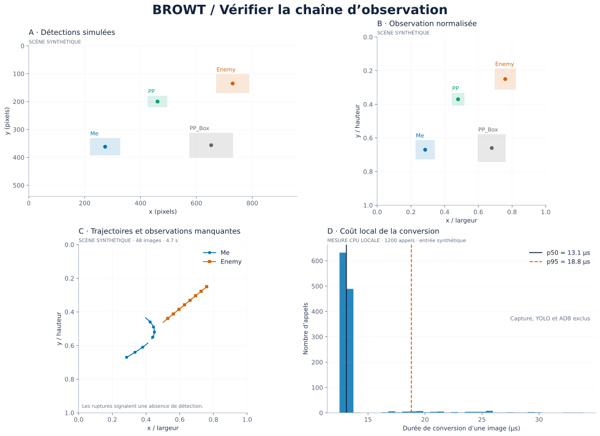

# BROWT · Laboratoire visuel de recherche

Étudier un agent Brawl Stars à partir de l’écran : **perception, observation,
décision**, avec des expériences reproductibles et une restitution scientifique
compréhensible. Mode initial : Solo Showdown.

Priorité confirmée : **recherche et visualisations scientifiques**.
Le projet démarre sur CPU ; NVIDIA/CUDA est la cible des entraînements futurs.

## Le plan et l’état réel

- [Plan complet sur 24 semaines indicatives](docs/roadmap.qmd)
- [Méthode expérimentale](docs/methodology.qmd)
- [Atlas des visualisations](docs/visual-atlas.qmd)
- [Journal et état des preuves](docs/progress.qmd)
- [Dataset public et import reproductible](docs/dataset.qmd)
- [Installation détaillée](docs/getting-started.qmd)

Le socle CPU, l’audit des annotations, les observations, les relectures et la
traçabilité sont implémentés. Le code de détection existe et est renforcé.
Le dataset public v21 est importé et analysé : 2 551 images et 11 643 boîtes.
[Premiers résultats réels et limites du découpage](docs/dataset-analysis.qmd).
La capture live, les actions, les baselines et le RL restent à construire.
**Aucune performance réelle de détection ou de jeu n’est encore établie.**

La documentation publiée sur [GitHub Pages](https://victor11w.github.io/BROWT/)
reflète uniquement les versions déjà publiées. Les modifications locales ne
sont pas automatiquement en ligne.

## Commencer sur CPU

Python 3.11 ou 3.12, depuis ce dépôt sous PowerShell :

```powershell
py -3.11 -m venv .venv
.\.venv\Scripts\python.exe -m pip install --upgrade pip
.\.venv\Scripts\python.exe -m pip install -e ".[research,dev]"
.\.venv\Scripts\python.exe -m BROWT doctor
.\.venv\Scripts\python.exe -m BROWT demo --output runs/research --figures docs/assets/figures
```

La dernière commande affiche un rapport HTML autonome. La scène est
**synthétique**, et la durée mesurée concerne seulement la conversion CPU des
observations. Elle ne nécessite ni dataset, ni modèle, ni émulateur.



## Outils disponibles

```text
python -m BROWT doctor [--json]
python -m BROWT demo --output runs/research
python -m BROWT audit --dataset data/dataset --output runs/dataset-audit.json
python -m BROWT replay --source chemin/detections.jsonl --output runs/replay
```

L’audit est en lecture seule : labels, boîtes normalisées, classes, fichiers
manquants et doublons exacts entre lots. Il ne prouve pas l’indépendance des
sessions ni la justesse visuelle des annotations.

Chaque expérience écrit un manifeste avec statut, configuration, environnement,
provenance et empreintes des artefacts. Les entrées réelles et synthétiques sont
distinguées.

## Détection

```powershell
.\.venv\Scripts\python.exe -m pip install -e ".[vision,research,dev]"
.\.venv\Scripts\python.exe -m BROWT.detection.train --smoke
.\.venv\Scripts\python.exe -m BROWT.detection.train
.\.venv\Scripts\python.exe -m BROWT.detection.report --weights chemin/weights/best.pt --split val
```

Préparer les lots indépendants `train/`, `valid/` et, pour l’évaluation finale,
`test/` en amont. Les sources ne sont ni déplacées ni réécrites.
Le mode rapide ne publie aucun poids et n’évalue pas le test.
Chaque run conserve son checkpoint ; `--publish` permet une copie explicite
sans écrasement. [Protocole détaillé](src/BROWT/detection/README.md).

## Qualité et rapport

```text
python -m pytest
python -m ruff check .
python -m ruff format --check src tests
quarto render docs --fail-if-warnings
```

Les tests d’entraînement utilisent un double de YOLO et ne constituent pas une
validation d’apprentissage. La CI CPU Windows/Linux et le rendu documentaire
sont configurés ; une exécution distante doit être observée avant de déclarer
la CI passée.

## Organisation

```text
src/BROWT/
  data/         audit et classes
  detection/    entraînement, inférence et évaluation
  state/        observations et replay de détections
  research/     provenance, statistiques et figures
  capture/      future capture réelle
configs/        paramètres d’expérience et plan de recherche
tests/          non-régression CPU
docs/           rapport Quarto et figures
runs/           artefacts locaux, non versionnés
```

Code sous licence MIT. Version et licence du dataset à consigner avec
l’export réellement utilisé.

Pour préparer le travail hébergé et les notifications Telegram, voir le
[guide d’autonomie](docs/autonomy.qmd). Le worker planifié n’est pas encore actif.
