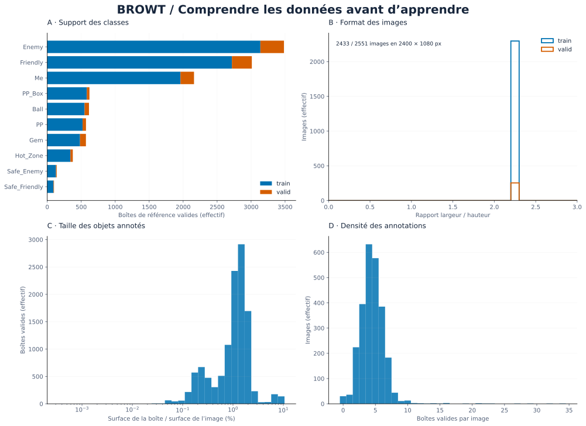
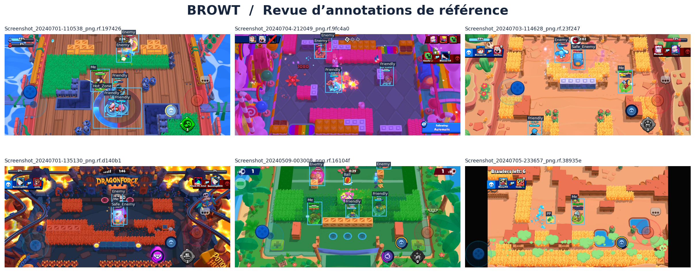
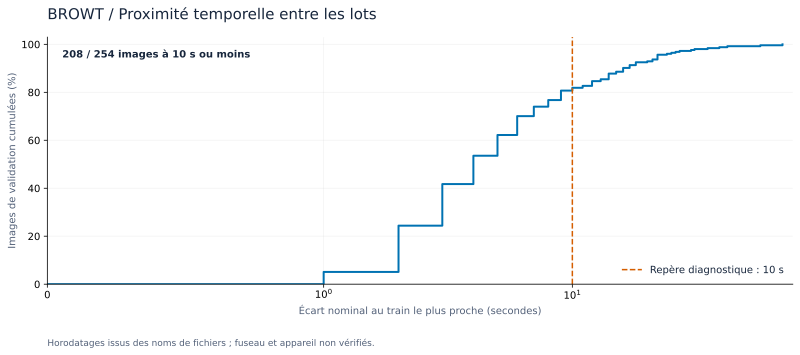
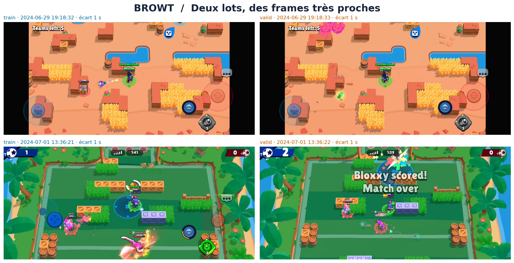

## Question et protocole

Peut-on utiliser la version 21 comme point de départ pour la perception, et quelles limites faut-il traiter avant de conclure sur un modèle ?

L’archive originale est conservée. L’analyse lit les fichiers d’apprentissage et de validation, contrôle les annotations, calcule leurs empreintes, décode chaque image et produit les figures. Les labels fournis sont des **annotations de référence** : aucune inférence YOLO n’est exécutée dans cette étude.

Les entrées sont identifiées dans `configs/dataset-lock.json`. Les résultats structurés et la provenance de la génération des figures figurent dans [le résumé exporté](assets/figures/dataset-study-summary.json).

## Intégrité et effectifs

| Contrôle | Résultat local |
|---|---:|
| Images d’apprentissage | 2 297 |
| Images de validation | 254 |
| Images décodées | 2 551 / 2 551 |
| Boîtes de référence valides | 11 643 |
| Anomalies structurelles d’annotation | 0 |
| Doublons de fichiers exacts entre les lots | 0 |
| Images avec un label de fond vide explicite | 30 |
| Test indépendant établi | Non |

Ces contrôles valident le format et la lisibilité des fichiers. Ils ne certifient ni l’exhaustivité sémantique des labels ni l’indépendance des acquisitions.

## Distribution et géométrie

{#fig-real-dataset-overview}

| Classe | Apprentissage | Validation | Total |
|---|---:|---:|---:|
| Ball | 549 | 65 | 614 |
| Enemy | 3 137 | 347 | 3 484 |
| Friendly | 2 718 | 293 | 3 011 |
| Gem | 482 | 87 | 569 |
| Hot_Zone | 341 | 35 | 376 |
| Me | 1 961 | 199 | 2 160 |
| PP | 520 | 50 | 570 |
| PP_Box | 582 | 39 | 621 |
| Safe_Enemy | 128 | 11 | 139 |
| Safe_Friendly | 92 | 7 | 99 |

La classe Enemy représente environ **29,9 %** des boîtes. Safe_Friendly n’a que **sept instances dans le lot de validation** : sa future AP devra être interprétée avec ce faible support, indépendamment du score global.

**2 433 images sur 2 551** sont en 2 400 × 1 080 pixels. Les 102 résolutions distinctes conservent presque toutes un rapport proche de 20:9. Le format de l’émulateur devra donc être choisi et évalué explicitement ; un passage à une capture 16:9 modifie les conditions d’observation.

La médiane de surface des boîtes est proche de **1,19 % de l’image**. La distribution couvre des objets nettement plus petits : la résolution d’inférence sera un facteur d’étude, sans extrapoler une qualité de détection à partir de ces tailles.

## Revue visuelle des annotations

{#fig-real-dataset-gallery}

Les exemples inspectés montrent des situations variées, dont des vues de spectateur et plusieurs objectifs de jeu. Les coffres visibles sont annotés Safe_Enemy ou Safe_Friendly dans les exemples correspondants. Cette observation remplace l’ancienne interprétation spéculative de ces classes comme des personnages cachés dans les buissons.

Dans les labels, **392 images n’ont aucun Me**, et **une image en a plusieurs**. L’absence d’un label Me ne prouve pas une annotation manquante : mort, vue de spectateur et autres contextes doivent être distingués par revue. La couche d’observation traite déjà explicitement les cas absent et ambigu.

Cette planche ne remplace pas une revue complète par classe, notamment pour les classes rares et les transitions de fin de partie.

## Un risque de corrélation entre les lots

Tous les noms d’images contiennent un motif d’horodatage exploitable. Ces noms couvrent **15 dates nominales**, du 6 mai au 21 juillet 2024. Le fuseau et l’identité de l’appareil ne sont pas certifiés.

Pour chaque image de validation, le diagnostic cherche l’image d’apprentissage dont l’heure nominale est la plus proche :

- **62 sur 254** ont un voisin à deux secondes ou moins ;
- **208 sur 254**, soit environ **81,9 %**, ont un voisin à dix secondes ou moins.

{#fig-temporal-gaps}

{#fig-temporal-pairs}

Ce résultat signale un risque important de frames corrélées entre apprentissage et validation. Un fichier différent et une empreinte différente ne garantissent pas une situation indépendante.

La proximité nominale ne prouve pas à elle seule l’identité d’une partie. Les exemples et les métadonnées doivent être examinés, puis regroupés de manière documentée. Il faudra aussi traiter les séquences pouvant traverser minuit : séparer les dates seules ne suffit pas automatiquement.

## Décisions pour la baseline

1. Conserver l’export public intact comme référence et pilote exploratoire.
2. Préparer un découpage dérivé par groupes d’acquisition, sans distribuer des frames proches entre lots.
3. Documenter la définition et les limites de ces groupes, ainsi que le support des classes après séparation.
4. Préparer un corpus indépendant adapté à Solo Showdown pour le test final.
5. Comparer les futurs modèles sur des données et budgets fixés, avec résultats par classe.

**Conclusion actuelle :** le dataset est exploitable pour préparer la perception, mais son découpage public ne suffit pas à démontrer la généralisation. Aucun mAP, gain RL ou taux de victoire n’est encore mesuré par BROWT.
