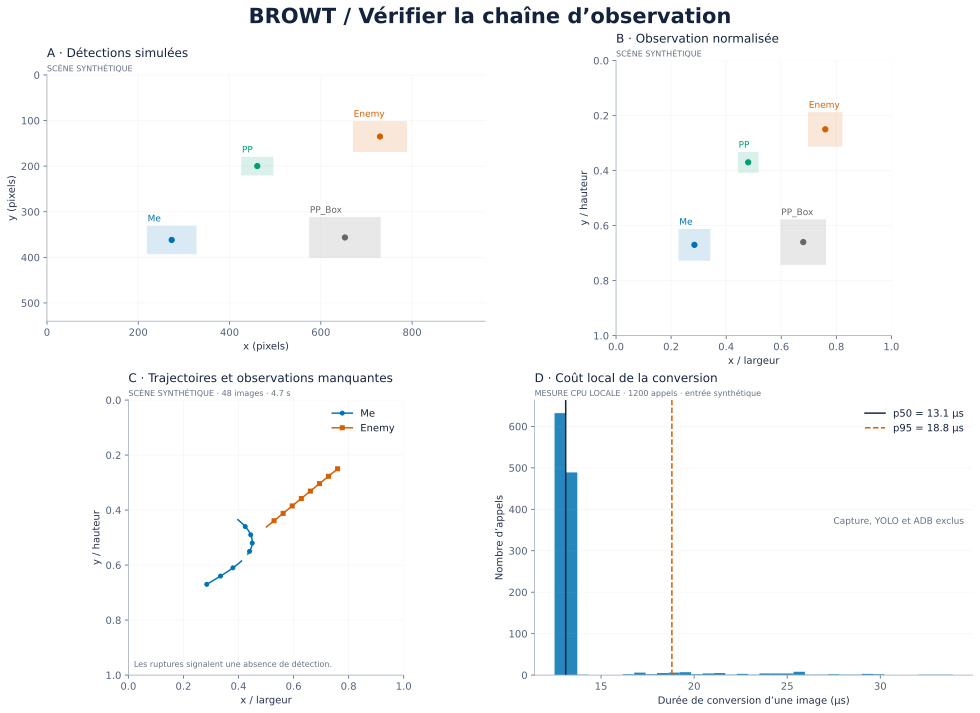

Brawl Stars · perception visuelle · apprentissage par renforcement

Étudier comment un agent peut passer des pixels à une décision, puis rendre chaque résultat compréhensible, vérifiable et reproductible.

Priorité : recherche scientifique
Démarrage sur CPU
Cible d’entraînement : NVIDIA / CUDA
Jalon actuel : analyse des données

BROWT est un projet de recherche de plusieurs mois. Le terrain d’étude est **Solo Showdown**. Le résultat attendu associe un système instrumenté, des expériences comparatives et un rapport visuel qui explique ce qui fonctionne, ce qui échoue et pourquoi.

<h3>1. Percevoir</h3>
Évaluer les objets détectés, les erreurs de localisation, les classes difficiles et les limites du dataset.

<h3>2. Décider</h3>
Construire des observations, des politiques de référence puis une expérience RL mesurable.

<h3>3. Expliquer</h3>
Relier chaque figure à ses données, son protocole et sa provenance.

## Lire le projet

- [Plan de recherche sur 24 semaines](roadmap.qmd) : étapes, dépendances et critères de passage.
- [Méthode expérimentale](methodology.qmd) : séparation des données, unités statistiques, baselines et reproductibilité.
- [Atlas des visualisations](visual-atlas.qmd) : quelle figure répond à quelle question.
- [Démarrer sur CPU](getting-started.qmd) : commandes disponibles immédiatement.
- [Journal d’avancement](progress.qmd) : réalisations effectives et travaux restants.

## Une première chaîne observable

{#fig-home-observation}

Cette démonstration vérifie les coordonnées, les absences du joueur et la production d’artefacts traçables. Le [chapitre Observation](observations.qmd) décrit ses hypothèses et ses limites.

::: {.callout-note title="État des preuves"}
Le dataset public v21 est récupéré et analysé : 2 551 images, 11 643 boîtes valides. Le découpage révèle un risque de corrélation temporelle entre train et valid ; voir [les résultats sur données réelles](dataset-analysis.qmd). Aucun score mAP, taux de victoire ou résultat RL n’est encore établi. Le GPU NVIDIA et l’émulateur restent à préparer pour les étapes suivantes.
:::
