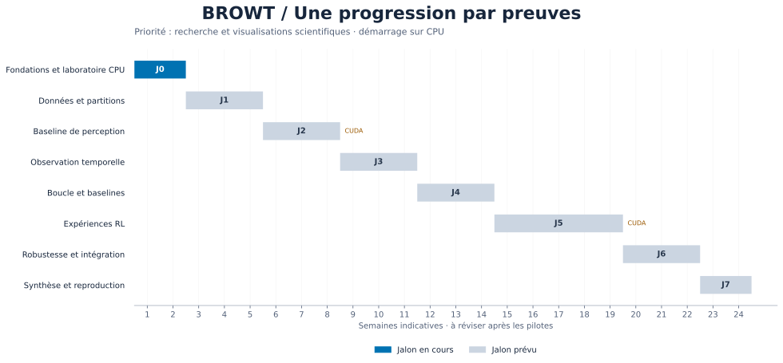

## Intention et définition de fin

**Question centrale :** avec quelles informations visuelles et quel budget de calcul un agent peut-il apprendre un comportement utile dans Brawl Stars, et comment expliquer ses succès et ses échecs ?

La priorité retenue est la **recherche et la visualisation scientifique**. La performance du bot est un objet de mesure. Une conclusion négative étayée est un résultat scientifique ; elle ne remplace toutefois pas la validation des composants annoncés comme opérationnels.

Le projet est considéré comme terminé lorsque :

1. une installation documentée permet de relire une séquence enregistrée et d’en reproduire les observations et les figures ;
2. un dataset audité possède des partitions gelées, un historique de provenance et une fiche descriptive ;
3. un détecteur est évalué sur des données indépendantes avec résultats globaux et par classe ;
4. une chaîne capture → perception → observation → politique → action peut être démontrée sur le contexte expérimental défini ;
5. des baselines et au moins une expérience RL sont comparées selon un protocole fixé, avec plusieurs graines et des limites d’interprétation ;
6. les figures, tableaux, données dérivées, configurations, versions et poids nécessaires à la reproduction sont archivés ;
7. le rapport final présente méthode, résultats, erreurs, limites, consommation de ressources et pistes suivantes ;
8. les tests CPU et les vérifications de documentation passent, et les essais matériels sont consignés séparément.

Les objectifs chiffrés de qualité, de latence et de jeu seront **fixés après le pilote et avant les comparaisons finales**. Aucun score arbitraire n’est présenté comme une exigence déjà justifiée.

## Calendrier et dépendances

{#fig-research-roadmap}

Le travail commence sur CPU. L’absence actuelle de GPU ne bloque ni l’architecture, ni l’audit des données, ni les visualisations, ni les relectures enregistrées. Elle limite les entraînements lourds et les conclusions sur les performances CUDA.

| Jalon | Semaines | Livrable principal | Dépendance |
|---|---:|---|---|
| J0 · Fondations | 1–2 | Outils CPU, tests, provenance, rapport visuel et protocole | Dépôt récupéré |
| J1 · Données | 3–5 | Dataset audité et partitions par session gelées | J0 + données |
| J2 · Perception | 6–8 | Baseline YOLO11n et analyse d’erreurs | J1 + calcul adapté |
| J3 · Observation | 9–11 | Capture/replay, observation temporelle et mesures de latence | J2, séquences réelles |
| J4 · Boucle et baselines | 12–14 | Environnement expérimental, actions calibrées et politiques simples | J3 + émulateur |
| J5 · Apprentissage | 15–19 | Comparaison RL avec plusieurs graines | J4 + budget CUDA |
| J6 · Robustesse | 20–22 | Évaluation hors distribution et boucle intégrée | J5 |
| J7 · Synthèse | 23–24 | Rapport final, démonstration et archive reproductible | J0–J6 |

Certaines tâches de documentation et d’analyse progressent en parallèle des expériences. Les jalons restent conditionnés à des preuves : on ne passe pas au RL pour compenser une perception défaillante.

## J0 — Installer un laboratoire fiable

**Travail.** Séparer les dépendances CPU, vision et RL ; créer une commande de diagnostic ; définir les formats d’observation et d’expérience ; corriger les écrasements de poids ; distinguer validation et test ; ajouter tests et CI ; définir les conventions graphiques.

**Livrables.** CLI `browt`, `manifest.json`, audit d’annotations, relecture de détections, démonstration synthétique, premiers SVG/PNG, plan et journal.

**Passage.** Les tests de non-régression passent ; la démonstration est exécutable sans GPU, modèle ni émulateur ; chaque résultat est identifié comme observé ou synthétique ; aucun entraînement rapide ne peut remplacer un modèle publié.

**État actuel.** Socle implémenté localement. La CI distante et le rendu Quarto nécessitent encore leur validation dans un environnement équipé.

## J1 — Construire des données évaluables

**Travail.**

- Retrouver l’export Roboflow, sa version exacte, ses classes et sa licence ; conserver les fichiers sources en lecture seule dans le protocole.
- Établir un inventaire images/annotations, vérifier les boîtes, les images vides, les classes rares et un échantillon visuel par classe.
- Repérer les doublons exacts et les quasi-doublons ; rechercher les frames proches et les sessions communes.
- Identifier les parties, sessions, cartes, personnages et versions du jeu ; séparer les groupes avant de créer les lots.
- Réserver des sessions pour la validation et un test final verrouillé ; ne pas distribuer aléatoirement des frames voisines entre lots.
- Mesurer le décalage entre le dataset public et les captures cibles.

**Livrables.** Fiche dataset, manifeste de fichiers et empreintes, tableau d’effectifs, planches d’annotations, partitions versionnées et registre d’exclusions.

**Passage.** Aucun doublon exact entre lots ; chaque classe requise possède un support documenté ; les groupes d’acquisition sont connus ou la limite d’indépendance est explicitée ; le test est gelé avant le réglage du modèle. Si les groupes du dataset public sont introuvables, créer un petit lot indépendant acquis localement.

## J2 — Établir une baseline de perception

**Travail.** Conserver YOLO11n comme baseline historique ; commencer par un test court puis une première expérience complète ; enregistrer graines, versions, augmentations, résolution et checkpoint ; comparer un seul facteur à la fois.

**Expériences.** Résolution, taille du modèle si le budget le permet, déséquilibre de classes, exemples difficiles et sélection du seuil de confiance sur validation.

**Mesures.** mAP@50–95, AP@50 par classe avec support, précision/rappel selon les seuils, faux positifs/faux négatifs, erreurs de localisation et vitesse après échauffement. Les classes absentes sont indiquées « non évaluées ».

**Figures.** Courbes précision–rappel, matrice de confusion explicitant sa normalisation, galerie de succès/échecs, qualité–latence et répartition des erreurs par situation.

**Passage.** Baseline reproductible sur validation, évaluation finale explicitement déclenchée, seuils d’usage documentés et goulots d’étranglement identifiés. Pilote à une graine puis cible de trois graines pour les comparaisons abordables ; adapter le nombre et l’incertitude au budget, sans faire passer un pilote pour une étude confirmatoire.

## J3 — Passer des détections à une observation temporelle

**Travail.** Capturer ou relire des séquences horodatées ; conserver la géométrie de la fenêtre ; convertir pixels et coordonnées normalisées ; représenter explicitement absences et ambiguïtés ; étudier l’intérêt du suivi temporel et de la mémoire.

**Écueils à traiter.** Occlusions, faux « Me », caméra mobile, changements de résolution, terrain statique absent des annotations et état partiellement observable. Une absence de détection n’est pas une preuve de disparition de l’objet.

**Livrables.** Sources de frames replay/live, journal de sessions, observations versionnées, schéma des repères, visualiseur de séquences et métriques de stabilité.

**Passage.** Relecture déterministe d’un enregistrement réel ; absence/ambiguïté du joueur correctement propagée ; synchronisation et latences de chaque étape mesurées ; défaillances de perception visibles dans le rapport.

## J4 — Définir une boucle expérimentale et ses baselines

**Travail.** Fixer personnage, carte, résolution et contexte d’essai ; calibrer les commandes ; séparer observation, décision et exécution ; vérifier les actions en mode simulation avant l’injection.

**Actions candidates.** Neuf mouvements discrets, dont l’immobilité, et une composante de tir. L’orientation, la simultanéité des contacts et le relâchement doivent être vérifiés sur l’émulateur : un simple swipe peut ne pas suffire à maintenir le joystick et tirer ensemble.

**Baselines.** Politique immobile, politique aléatoire reproductible, politique heuristique simple. Elles partagent exactement les observations, les contraintes d’action et le protocole d’évaluation des agents appris.

**Récompense.** Définir séparément score principal, signaux auxiliaires et pénalités ; valider visuellement les événements. La variation des pixels, seule, ne constitue pas une récompense fiable.

**Livrables.** Contrat Gymnasium, tests de transitions, journal observation/action/événement, calibration ADB et premiers épisodes annotés.

**Passage.** Débuts/fins d’épisode fiables ; distinction fin naturelle/limite de temps ; pas d’action persistante après arrêt ; métriques de référence disponibles et estimation du coût d’un épisode.

## J5 — Étudier l’apprentissage

**Travail.** Geler une représentation initiale et une récompense ; vérifier d’abord l’apprentissage sur une tâche réduite ; comparer ensuite une baseline RL adaptée à l’espace d’action.

**Choix prévus.** PPO comme candidat initial pour l’action factorisée ; DQN seulement avec une action discrète correctement définie. Q-learning tabulaire reste une référence possible sur une abstraction très réduite. Ces choix seront réexaminés après J4, sans chercher à comparer tous les algorithmes.

**Protocole.** Séparer graines d’entraînement et sessions d’évaluation ; fixer un budget d’interactions et de calcul identique pour les comparaisons ; conserver les runs interrompus et les échecs ; évaluer une politique figée sur des épisodes indépendants.

**Figures.** Courbes par graine et agrégats justifiés, score par budget d’interactions, distribution des résultats finaux et chronologie d’épisodes représentatifs. Ne pas lisser au point de cacher les effondrements.

**Passage.** Au moins une expérience RL complète avec une baseline comparable ; plusieurs graines pour toute affirmation générale ; explication des écarts et limites de puissance statistique. Une absence d’amélioration entraîne une analyse, pas une retouche du test final.

## J6 — Intégrer et éprouver

**Travail.** Évaluer cartes, situations, personnages ou sessions non vus selon une matrice définie ; analyser la propagation des erreurs ; vérifier dérive temporelle, perte de fenêtre, capture figée, joueur absent et interruptions.

**Mesures.** Score principal, réussite/survie selon le protocole, coût de calcul, latences p50/p95 de la boucle complète, taux de frames invalides et fréquence des arrêts.

**Passage.** Démonstration intégrée enregistrée ; conditions de validité explicites ; cas d’échec reproductibles ; comparaison finale sans changement opportuniste de métriques.

## J7 — Fermer proprement l’étude

**Travail.** Reproduire une sélection d’expériences depuis un environnement propre ; figer les configurations et poids ; harmoniser légendes, unités et tableaux ; archiver données dérivées et scripts.

**Livrables finaux.**

- Rapport scientifique HTML lisible et export des figures vectorielles.
- Vidéo courte expliquant perception, observation, décision et échecs.
- Fiches dataset et modèle ; versions, empreintes et procédure de reproduction.
- Résultats comparatifs avec incertitude et périmètre de généralisation.
- Guide d’installation CPU puis CUDA ; démonstration offline et démonstration intégrée.
- Liste explicite des limites et des travaux futurs, sans fonctionnalité annoncée comme réalisée sans preuve.

**Passage final.** Chaque conclusion renvoie à une expérience ; chaque figure renvoie à ses données ; les résultats sélectionnés sont reproductibles ; les limitations matérielles et expérimentales sont documentées.

## Gestion du temps, du calcul et des inconnues

| Incertitude | Conséquence | Réponse prévue |
|---|---|---|
| GPU NVIDIA indisponible | Entraînements lourds retardés | Développer et analyser sur CPU ; réaliser un pilote avant de dimensionner le calcul |
| Dataset/poids antérieurs introuvables | Baseline à reconstruire | Repartir d’un export identifié et tracer la nouvelle lignée |
| Frames très corrélées | Résultats surestimés | Partitionner par session et évaluer sur acquisition indépendante |
| Jeu/émulateur instable | Épisodes coûteux ou invalides | Construire d’abord capture/replay et tests de transitions |
| Récompense peu fiable | Apprentissage trompeur | Vérifier les événements et comparer à des épisodes annotés |
| Résultats RL très variables | Comparaison fragile | Plusieurs graines, intervalles adaptés et budget explicitement limité |
| Périmètre trop large | Analyse inachevée | Un mode, un personnage et un contexte initial ; élargissement seulement après validation |

Le premier pilote mesure le temps par époque, la mémoire, la vitesse de collecte et le coût par épisode. Ces mesures déterminent le budget ; elles ne sont pas remplacées par une estimation inventée. Aucune ressource payante ou machine distante n’est engagée par ce plan.

## Manière de travailler

Le [journal](progress.qmd) indique le jalon courant, ses preuves, ses blocages et la prochaine action. Les [décisions](decisions.qmd) conservent le raisonnement des choix structurants. Le code, les expériences et le rapport évoluent ensemble.

Une avancée scientifique se termine par une question traitée, un protocole exécutable, des données archivées, une figure expliquée et une limite identifiée. Les essais exploratoires restent distincts des résultats figés.
