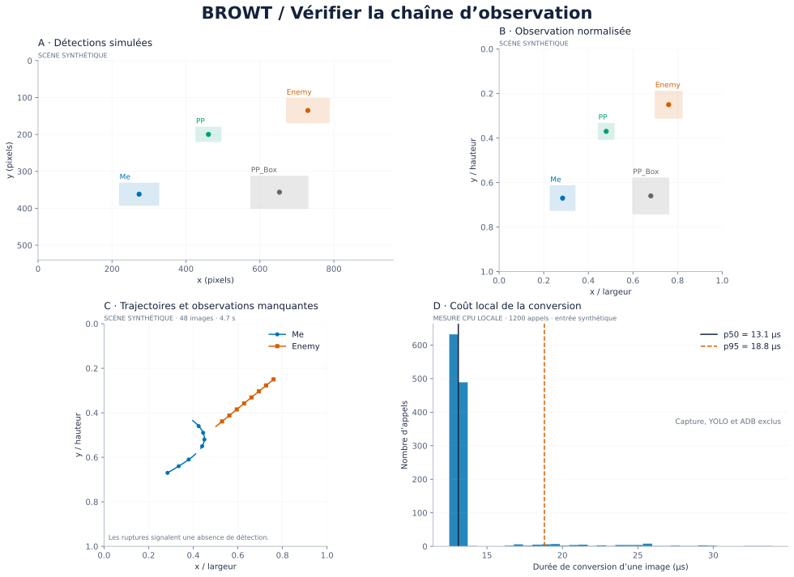

## Grammaire commune

Les figures scientifiques utilisent une typographie lisible, des axes nommés avec unités, une palette compatible avec les déficiences de perception des couleurs et des symboles ou styles redondants. Les exports principaux sont **SVG** et **PNG** ; un export PDF pourra accompagner le rapport final.

La couleur porte une signification stable : joueur, ennemi, classe, condition ou statut. Elle ne décore pas arbitrairement chaque catégorie. Les données absentes créent une rupture ou une mention « non évalué ».

Chaque légende précise les entrées, le protocole, le nombre d’unités, le calcul de l’incertitude et les exclusions. Les intervalles sont définis ; une zone ombrée ne signifie pas automatiquement « intervalle de confiance ».

## Les planches à produire

| Figure | Question | Données et unités | Attention principale |
|---|---|---|---|
| Frise des jalons | Que doit-on établir, et dans quel ordre ? | Semaines indicatives et dépendances | Un calendrier n’est pas une preuve d’avancement |
| Distribution du dataset | Quelles classes et situations dominent ? | Images, instances et sessions | Instances et images sont des effectifs différents |
| Planche d’annotations | Les labels correspondent-ils aux objets ? | Exemples sélectionnés par classe | Montrer aussi les ambiguïtés |
| Répartition des partitions | Les groupes sont-ils indépendants ? | Sessions/cartes/personnages par lot | Les doublons exacts ne couvrent pas les quasi-doublons |
| Courbes précision–rappel | Quel compromis offre le détecteur ? | Référence annotée et scores | Indiquer seuils, IoU et classes présentes |
| Matrice de confusion | Quelles erreurs se ressemblent ? | Effectifs bruts et normalisés | Nommer le sens de normalisation |
| Galerie d’erreurs | Comment le système échoue-t-il ? | Faux positifs/négatifs, contexte | Éviter une sélection seulement flatteuse |
| Qualité–latence | Quel modèle est utilisable au budget cible ? | AP et ms/image sur matériel identifié | Séparer CPU, GPU et boucle entière |
| Pixels → observation | Que reçoit la politique ? | Boîtes, repères, absences, variables | Ne pas assimiler observation et état interne réel |
| Trajectoires et suivi | L’observation est-elle stable dans le temps ? | Coordonnées, identités, horodatage | Ruptures explicites, mouvements de caméra |
| Chronologie d’épisode | Pourquoi une action a-t-elle été choisie ? | Frames, observation, action, événement, récompense | Synchroniser les horloges |
| Courbes d’apprentissage | Quel progrès pour quel budget ? | Interactions, graines, scores d’évaluation | Montrer dispersion et entraînements échoués |
| Comparaison finale | Le gain est-il robuste ? | Résultat par graine/partie, protocole fixé | Un meilleur run ne résume pas une méthode |
| Ablations | Quel composant compte réellement ? | Contrastes contrôlés et incertitude | Garder budgets et données comparables |
| Robustesse | Où la généralisation se dégrade-t-elle ? | Cartes, sessions, personnages, situations | Ne pas masquer les groupes peu représentés |

Les figures sans données disponibles restent dans cette liste de travail. Elles ne sont pas remplies avec des scores fictifs.

## Première planche exécutable

{#fig-atlas-observation}

Les trajectoires sont artificielles et les scores de confiance sont simulés pour tester les interfaces. Ils ne représentent ni la confiance calibrée d’un modèle ni une précision mesurée.

La distribution de temps contient tous les appels après échauffement. Les appels répétés au même traitement ne constituent pas des épisodes indépendants de jeu.

## Lisibilité et exploration

Les figures statiques doivent suffire à lire le rapport. Un visualiseur interactif de séquences viendra ensuite pour avancer image par image, afficher les erreurs et relier décision et observation. Il utilisera les mêmes données archivées.

Le rapport de démonstration actuel est autonome, lisible hors ligne et sans dépendance à un service externe. Il permet d’agrandir les figures vectorielles et d’ouvrir les artefacts bruts associés.

## Liste de contrôle d’une figure finale

- Question explicite, unités visibles et repères définis.
- Provenance accessible : identifiant du run, données, configuration et code.
- Support et exclusions annoncés ; absence distincte d’un zéro.
- Incertitude définie et unité statistique cohérente.
- Couleurs et symboles cohérents avec les autres figures.
- Légende qui permet de comprendre l’essentiel sans relire tout le chapitre.
- Source génératrice versionnée et export vectoriel conservé.
